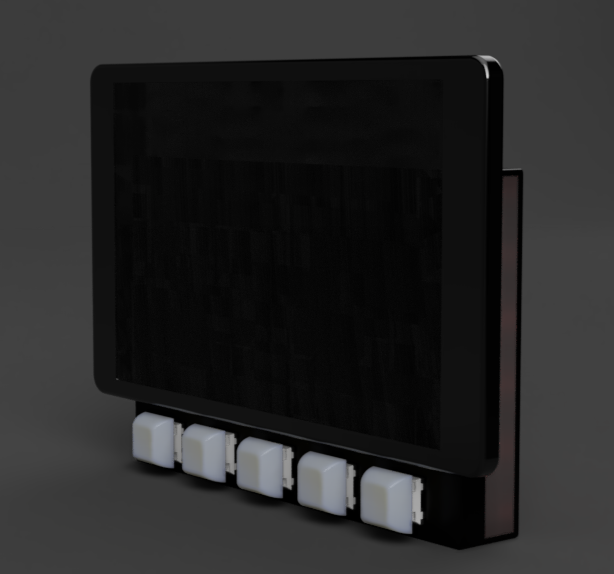
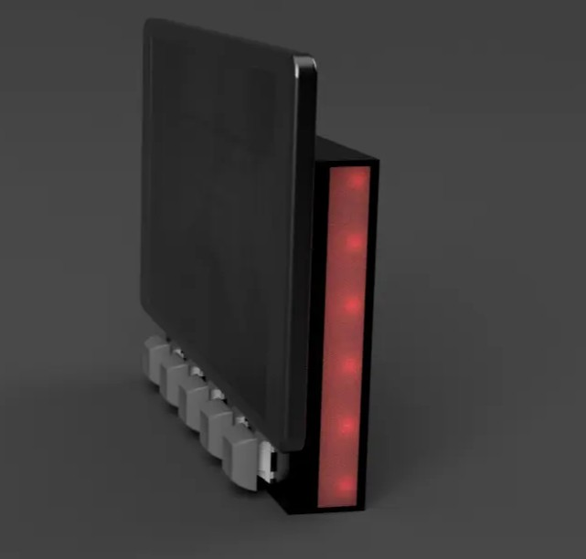
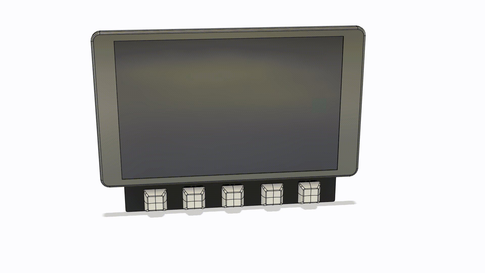
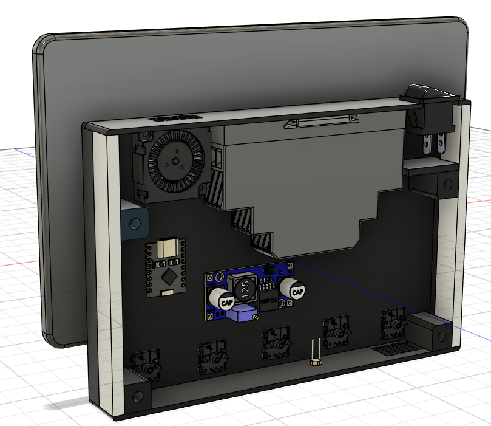

# Home-Assistant-Dashboard

A wall-mounted tablet with addressable buttons and RGB lighting. Usedofr displaying a Home Assistant Dashboard.

 

## What is it?

This device is made from an old Samsung tablet and can be used as a Home Assistant dashboard. It has 5 addressable buttons for navigating your dashboards, and two RGB strips consisting of 6 individually controllable LED's each.

The buttons and LED strips are managed by Home Assistant, this is done with the ESP32 inside of the device that has ESPHome installed on it. The whole device is powered by a 5v DIN-rail module that turns mains voltage into 5V. And the device is cooled with a 5V laptop fan.

The tablet has had its battery removed to prevent a fire from starting because of an old degrated battery. The tablet is hooked up to a stepdown module delivering 4V to the tablet's battery terminals.

## Why did I make it?

I have always wanted an easier way to control lights and view our camera's from the living room. With this device I can do all of that and also have the device itself act as a camera to monitor the house when on vacation. And on top of that I can also use the device as an indication of the status of sensors, like the device flashing yellow when someone is almost home or flashing red when movement is detected in front of our house.

## How to assemble it?

The device is made up of 2 3D-printed parts, the main case and the backplate. Those parts can be put together using screws. The tablet is also installed using screws into the main case. The buttons can easily be popped in, and the 5v DIN module has a special DIN rail that it click onto.

## Software

The firmware is a .yaml ESPHome config file. You must first change all `CHANGE_ME` values with a random API key, the wifi credentials, and ap password. Then you should plug in the ESP32 to your pc and go to [web.esphome.io](https://web.esphome.io). Finally just upload the .yaml file and after flashing it, it should automatically appear in Home Assistant under Devices & Services.
